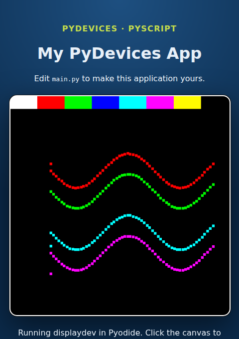

# PyScript template

PyScript template is a starter for an installable browser app that draws with
the PyDevices display stack: Python (Pyodide) on a canvas, working offline once
it has loaded.

On GitHub, press **Use this template**, or clone it, then serve it from
localhost:

```bash
git clone https://github.com/PyDevices/pyscript-template my-app
cd my-app
./scripts/vendor_pyscript.sh
python3 -m http.server 8000
```

Open <http://localhost:8000>. Here is a paint app in 20 lines; it is a cut-down
[`main.py`](main.py), which also sets a 500x500 display size:

```python
import board_config, appdev
from pyscript import document
display, app = board_config.display_drv, appdev.App(board_config)
colors = [0xFFFF, 0xF800, 0x07E0, 0x001F, 0x07FF, 0xF81F, 0xFFE0, 0x0000]
block, selected = display.width // len(colors), 0
for i, color in enumerate(colors):
    display.fill_rect(i * block, 0, block, 30, color)
display.show()
document.querySelector("#status").textContent = "Pick a colour, then paint."
def on_touch(event):
    global selected
    x, y = event.pos
    if y < 30:
        selected = min(len(colors) - 1, x // block)
    else:
        display.fill_rect(x - 3, y - 3, 6, 6, colors[selected])
        display.show()
app.on(app.events.MOUSEBUTTONDOWN, on_touch)
app.on(app.events.MOUSEMOTION, on_touch)
app.run()
```

Click a colour block along the top, then move the pointer over the canvas to
paint. The picture at the top of this page is that app after four strokes.

[Docs](https://github.com/PyDevices/pyscript-template/blob/main/docs/index.md) · [Examples](https://pydevices.github.io/gallery/gallery/) · [Roadmap](ROADMAP.md)

Made by [PyDevices](https://pydevices.com).
